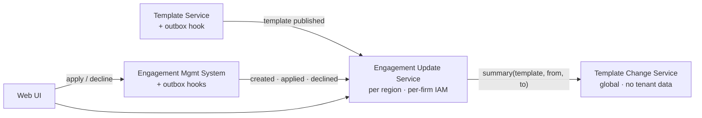
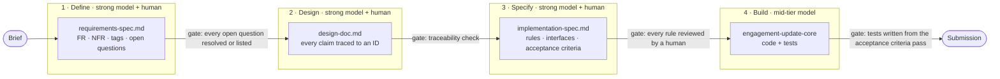

# Engagement Template Update Tracking

**Refactoring Team Design Exercise**.

This repository contains a design for showing users which engagement files have pending product-template updates, with a human-readable summary of each update and a record of every apply/decline decision. It also contains a small, fully tested implementation slice of the design's core rules.

The README covers what is here, what to read first, and **how AI was used to produce it**: a spec-driven workflow that spends strong models on ambiguity and mid-tier models on well-defined execution.

---

## Deliverables

| Brief deliverable | Where |
|---|---|
| 1. Design document | [`docs/design-doc.md`](docs/design-doc.md) |
| 2. Code | [`engagement-update-core/`](engagement-update-core/), specified by [`docs/implementation-spec.md`](docs/implementation-spec.md) |
| 4. Diagrams | Mermaid, inline in the design doc. They render directly on GitHub. |
| Supporting: requirements baseline | [`docs/requirements-spec.md`](docs/requirements-spec.md) |

## Reading order

| # | Document | What it answers | Time |
|---|---|---|---|
| 1 | [`docs/design-doc.md`](docs/design-doc.md) | The architecture, plan, testing, observability, failure modes and tradeoffs. Start with its **TL;DR**. | 10 min |
| 2 | [`docs/requirements-spec.md`](docs/requirements-spec.md) | What the brief requires, what it implies, and which assumptions were made. Every design claim traces back to an ID here. | 5 min |
| 3 | [`docs/implementation-spec.md`](docs/implementation-spec.md) | The exact rules, interfaces and acceptance criteria of the code slice. | 5 min |
| 4 | [`engagement-update-core/`](engagement-update-core/) | The code and tests. Its README maps each test to the rule it proves. | as needed |

## The problem

Engagement files are created from a version of a product template. Templates keep getting updates, about once a week per product. For each engagement, a firm must either apply or decline each update. Users need to see at a glance which engagements have pending updates and read a plain-language summary of what changed.

The hard constraint is that an engagement's template version can only be read by **loading** the engagement, which takes about one minute per file. On top of that, the template store is shared across all firms, while engagement data is client-confidential, isolated per firm, and subject to data-residency rules.

## The solution

- **Hooks with the outbox pattern.** The two existing systems publish events on publish, create, apply, decline and archive. The events go through a transactional outbox, so none is lost.
- **Template Change Service.** A global service that holds no tenant data. It turns a template diff into a deterministic, section-grouped summary, and every bullet links back to the raw diff entry it came from.
- **Engagement Update Service.** Deployed per residency region. It keeps each engagement's version, decision history and impact counts in DynamoDB, partitioned by firm.
- **Pending computed at read time.** An engagement is pending when its template's latest version is newer than both its applied and declined versions. A publish is one write per region, never one per engagement.
- **No engagement load on any user path.** The one-minute load happens only in a one-time, throttled, off-peak backfill.
- **Tenant isolation enforced by AWS IAM.** Credentials are scoped to the firm's partition key, so isolation does not depend on application-level filters.



The full picture, including the event routes, failure modes and every tradeoff, is in the [design doc](docs/design-doc.md).

## Running the code

```bash
cd engagement-update-core
./gradlew test
```

This requires Java 21. The slice is plain Java with JUnit 5, AssertJ and jqwik. It uses no Spring and needs no AWS, because it proves the domain rules (sequence numbers, backfill precedence, the pending rule and impact counts) against in-memory stores that imitate DynamoDB's conditional writes.

---

## How this was built: spec-driven development with AI

AI was used throughout, but **never as the source of truth**. Each phase produces a written artifact that the next phase must conform to, and each phase ends at a gate that a human checks before moving on.



### Match the model to the ambiguity

| Phase | Artifact | Model tier | Why this tier |
|---|---|---|---|
| 1. Define | [`requirements-spec.md`](docs/requirements-spec.md) | Strong (Claude Opus) | The brief is ambiguous: decline semantics, accumulated updates, what counts as "up to date". This is where reasoning quality matters most, and where a plausible wrong guess is most expensive. |
| 2. Design | [`design-doc.md`](docs/design-doc.md) | Strong (Claude Opus) | The design has to weigh tradeoffs across scale, security, residency and failure modes, and check every choice against the requirements. |
| 3. Specify | [`implementation-spec.md`](docs/implementation-spec.md) | Strong (Claude Opus) | Turning the design into exact rules and acceptance criteria removes the last ambiguity before any code is written. |
| 4. Build | [`engagement-update-core/`](engagement-update-core/) | Mid-tier (Claude Sonnet) | By now every rule, interface and acceptance test is written down, so the task is execution, not judgment. A mid-tier model does it reliably at a fraction of the cost. |

The principle is to **spend expensive reasoning where ambiguity is high, and stop spending it once ambiguity is gone.** A strong model writing boilerplate against a precise spec is wasted money. A mid-tier model designing against an ambiguous brief produces architecture that looks plausible but is wrong. Phases 1 to 3 exist to turn the second situation into the first.

### Guardrails against hallucination

| Guardrail | Where | What it catches |
|---|---|---|
| Every requirement is tagged **[E]** (explicit in the brief), **[I]** (implied) or **[D]** (follows from a recorded decision). | Requirements spec | Requirements the AI invented. Anything without a source in the brief or a recorded decision is not a requirement. |
| Ambiguity becomes an **open question**, and is closed only by a recorded assumption (A-1 to A-10). | Requirements spec §4 and §5 | Questions the AI silently answered on its own. Each assumption is explicit and can be challenged in review. |
| Every design element cites requirement IDs. | Design doc | Scope creep, meaning design with no requirement behind it, and gaps, meaning requirements with no design behind them. |
| Rules are written as testable statements (R1 to R10) with acceptance criteria (AC-1 to AC-13). | Implementation spec | Vague behavior that code could "satisfy" in several different ways. |
| Tests come from the acceptance criteria, **not from the generated code.** | Implementation spec §13 | Tests that simply confirm whatever the code happens to do. |
| The property-based test's **oracle is written by hand** and reviewed separately. | Implementation spec §13 | An oracle that shares the implementation's bugs because both were generated together. |
| Claims about cloud services are checked against AWS documentation. | Design review | Confident but wrong claims about service capabilities and limits. |

### Answers for the follow-up review

**Where AI helped**
- Extracting requirements from the brief and sorting them into explicit, implied and decided.
- Enumerating open questions, including edge cases such as the backfill race and decisions made on a stale summary.
- Generating alternatives for each tradeoff: DynamoDB vs. PostgreSQL, SNS/SQS vs. EventBridge vs. Kafka, on-demand vs. pre-built summaries.
- Drafting the Mermaid diagrams.
- Generating the slice's code and tests from a precise spec, with a mid-tier model.

**Where AI output was corrected or ignored**

> **TODO (author):** add 2 or 3 concrete examples from the session history. Each example should say what the model proposed, why it was wrong, and what replaced it.

**How I would guide other engineers using AI on this system**
1. Don't let a model design against the raw brief. Write the requirements spec first and make it the model's contract.
2. Use strong models for the define, design and specify phases, and mid-tier models for building against a finished spec.
3. Require every AI-produced claim to trace to a requirement ID. Treat an untraceable claim as a defect.
4. Write tests from the acceptance criteria before reading the generated code, and write the test oracles by hand.
5. Review every domain rule yourself. The costly bugs here are plausible-looking ones, such as a decline moving the baseline or a backfill overwriting live state.

**Where AI should not be trusted in this domain**
- **Generating the change summaries that users read at runtime.** Auditors need summaries that are reproducible and traceable to the source. That is why the summaries are produced by deterministic rules, with an LLM used at most to help authors draft rule wording offline.
- **Audit semantics.** Questions such as what a decline means, or what the summary baseline should be, are product decisions to record as assumptions, not details for a model to fill in.
- **Tenant isolation and IAM policy.** These must be tested against real AWS. Model output and mocks are not evidence.
- **Concurrency and ordering correctness.** Generated code that looks right under a single thread proves nothing. It needs property-based and concurrency tests.
- **Cloud service limits and capabilities.** Verify them against AWS documentation.

---

## Key decisions at a glance

| Decision | Choice | Details |
|---|---|---|
| How changes are detected | Hooks with a transactional outbox, not polling | [Design §1.1](docs/design-doc.md#11-events-and-the-outbox) |
| Accumulated updates | One cumulative summary from the last applied version to the latest; decisions are all-or-nothing | A-1, A-2 |
| Pending state | Computed at read time, not stored per engagement | [Design §1.3](docs/design-doc.md#13-engagement-update-service) |
| Summaries | Deterministic rules, every bullet linked to the raw diff, no runtime LLM | A-5 |
| Storage | DynamoDB per region, partitioned by firm | [Design §5](docs/design-doc.md#5-failure-modes--tradeoffs) |
| Isolation | IAM `dynamodb:LeadingKeys` scoped to the firm | [Design §1.6](docs/design-doc.md#16-tenant-isolation) |
| Existing engagements | One-time, throttled, per-region, off-peak backfill that never overwrites live state | A-3, A-7, A-9, FR-17 |
| Consistency | Eventual. P99 of updates visible within 5 minutes of publish, and stale decisions are rejected with `409` | A-4, A-8, FR-14 |

## Repository layout

```
.
├── README.md                    ← you are here
├── docs/
│   ├── requirements-spec.md     phase 1: requirements baseline
│   ├── design-doc.md            phase 2: the design (primary deliverable)
│   └── implementation-spec.md   phase 3: contract for the code slice
└── engagement-update-core/      phase 4: code slice + tests
```
