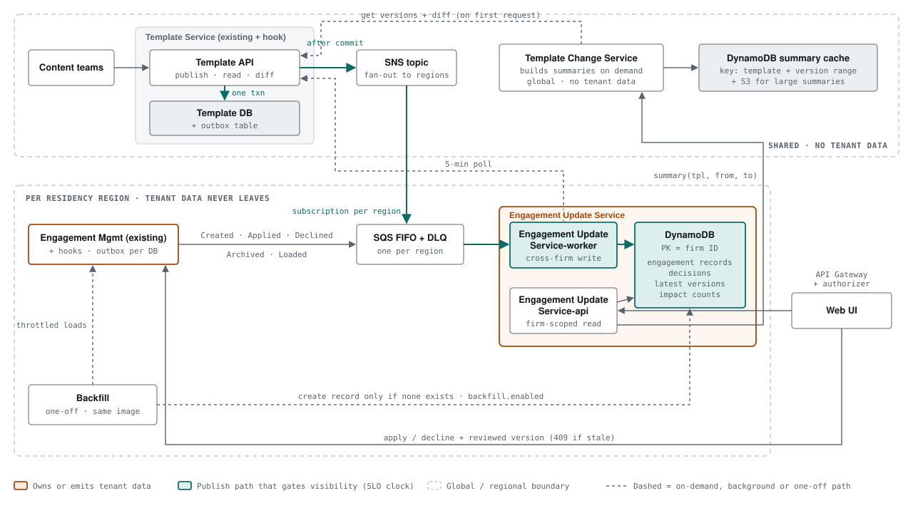
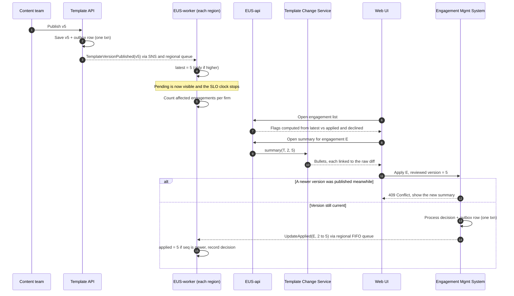
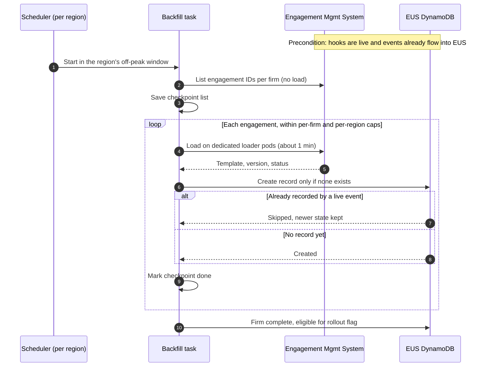

# Design: Pending Template Update Tracking

| | |
|---|---|
| **Status** | Proposed · v8 |
| **Requirements baseline** | [`requirements-spec.md`](requirements-spec.md) v0.3 |
| **Implementation slice** | [`implementation-spec.md`](implementation-spec.md) |

IDs such as `FR-7`, `NFR-SEC2` or `A-2` refer to the requirements spec.

## TL;DR

- **We extend, we don't watch.** The two existing systems get hooks (C-5) that publish events through a **transactional outbox**. No event is lost, and no event is sent for a change that didn't commit.
- **We add two services, each with one responsibility:**
  - **Template Change Service (TCS)** is global and holds no tenant data. It explains what changed between two template versions.
  - **Engagement Update Service (EUS)** runs per residency region. It knows where each engagement stands: its version, decisions and impact counts.
- **Pending is computed at read time**, as `active && latest > max(applied, declinedThrough)`. A publish is one write per region, never one per engagement.
- **No engagement is loaded to answer a question.** The one-minute load (NFR-P1) appears only in a one-time, throttled, off-peak backfill.
- **Tenant isolation is enforced by AWS IAM** on the DynamoDB partition key, not by application filters.

**Names used below.** EUS runs as two processes: **EUS-api**, which serves user reads, and **EUS-worker**, which consumes the queues. **EMS** is the existing engagement management system.

---

## 1. Target Architecture


| Component | Status | Responsibility |
|---|---|---|
| Template Service | Existing **+ hook** | Owns templates. Publishes `TemplateVersionPublished` through its outbox. |
| EMS | Existing **+ hooks** | Owns engagements and processes decisions (C-4). Publishes create, apply, decline, archive and load events through an outbox in each customer database. |
| SNS topic, SQS queues | New, managed | Fan template events out to every region, and carry engagement events within a region. Every queue has a dead-letter queue (DLQ). |
| **TCS** | **New**, global | Builds, caches and serves change summaries. |
| **EUS** | **New**, per region | Engagement state, pending flags, decision history and impact counts. |
| Backfill | New, one-off | Seeds existing engagements once and is then decommissioned. Built from the EUS image. |

### 1.1 Events and the outbox

Saving a change and publishing its event are two separate steps, and a crash between them silently corrupts pending flags. In an audit product, that is a correctness failure. So every hook uses the transactional outbox:

1. **One transaction** saves the change **and** an outbox row. Both commit, or neither does.
2. After the commit, the row is sent and marked as sent.
3. A relay sends any row that is still unsent, which covers a crash between steps 1 and 2.
4. **Order is preserved at the source.** A row is sent only once every older row for the same engagement has been sent. Together with the FIFO queue, grouped by engagement ID, this means EUS receives each engagement's events in sequence order.

The result: no event is lost, no event is sent for an uncommitted change, each engagement's events arrive in order, and the worst case is a duplicate, which the sequence-number check drops.

| Event | Producer | Tenant data | Route |
|---|---|---|---|
| `TemplateVersionPublished` | Template Service | None | SNS to a standard SQS queue in every region. Order doesn't matter, because the latest version only ever rises. |
| `EngagementCreated`, `UpdateApplied`, `UpdateDeclined`, `EngagementArchived`, `EngagementLoaded` | EMS | Yes | Sent directly to the region's FIFO queue, so the events **never leave the region** (NFR-SEC4). Each carries a sequence number that only increases for that engagement. |

We use two queues per region because SNS standard topics can't deliver to FIFO queues, and template events don't need ordering anyway.

### 1.2 Template Change Service

- **Built on demand.** The first request for a range, such as `(T, v4, v12)`, fetches both versions, diffs them (C-2), applies the rules and caches the result. Later requests for the same range come from the cache. Any range works, and nothing is built for ranges nobody opens.
- **Single-flight per range.** On publish day, many users may open the same range at once. Only one request builds it, and the others wait for that result.
- **Deterministic and traceable.** Rules map each diff entry to a bullet, grouped by template section. Every bullet links to its exact location in the diff (FR-6, FR-7, FR-7a). The same inputs always produce the same summary.
- **Nothing is dropped.** A change that no rule recognizes still gets a generic bullet, with its link.
- **Storage.** A DynamoDB table keyed by template and version range, with large summaries in S3.
- **No tenant data.** Requests name only a template and two versions.

### 1.3 Engagement Update Service

**Data.** DynamoDB, with one set of tables per region.

| Item | Partition key | Contents |
|---|---|---|
| Engagement record | `firmId` | template, `appliedVersion`, `declinedThroughVersion`, status, `lastSeq` |
| Decision | `firmId` | outcome, from-version, to-version, actor, time. Append-only (FR-9, NFR-O3). |
| Latest version | `templateId` | The latest published version. Holds no tenant data. |
| Impact count | `templateId#version` | Affected count per firm, and the time it was computed. |

| Access pattern | How it is served |
|---|---|
| A firm's engagement list | One query on the firm partition, plus one batch read of its templates' latest versions |
| A firm's decision history | The same firm partition |
| Engagements on a template, for impact counts | A secondary index on `templateId`, used by EUS-worker only |
| The worker's correctness rules | Two conditional writes: "apply only if `seq` is newer", and "create only if absent" |

**Pending rule** (FR-1, FR-4, FR-10):

```text
pending = status == ACTIVE
       && latest(template) is known
       && latest(template) > max(appliedVersion, declinedThroughVersion ?? 0)
```

**EUS-worker**

- **On a template publish:**
  1. Raise the template's latest version, but only if the new version is higher. This is the **only** step users wait on, so the SLO does not depend on firm size (NFR-P5).
  2. Count the affected **active** engagements per firm, in parallel with a per-firm cap, and record each count with the time it finished (FR-12, NFR-O1, NFR-S2). A firm with no recorded count is a firm where the check didn't run (NFR-O2).
- **On an engagement event,** apply it only if `seq > lastSeq`:

  | Event | Effect |
  |---|---|
  | Created | Creates the record. |
  | Applied | Sets `appliedVersion = to` and appends a decision. |
  | Declined | Sets `declinedThroughVersion = max(current, to)` and leaves `appliedVersion` unchanged (A-2). Appends a decision. |
  | Archived | Sets status to `ARCHIVED`. |
  | Loaded | Used only to check for drift (§4). |

- **Safety net.** Every 5 minutes, the worker reconciles the latest versions against the Template API, in case a publish event reached the region late.

**EUS-api** serves three things: the engagement list with pending flags, an engagement's summary (fetched from TCS), and the decision history.

### 1.4 Decisions (FR-8, FR-14)

Decisions stay in EMS, where the brief puts them. The UI sends each decision along with the version the user reviewed. EMS already reads the template database, so if a newer version has been published since, it rejects the decision with **`409 Conflict`** and the UI shows the updated summary. Otherwise, EMS processes the decision, and its outbox emits `UpdateApplied` or `UpdateDeclined`.

### 1.5 Backfill (FR-15, FR-17)

- **Timing.** It runs per region, during that region's off-peak window (A-9), and only after the hooks are live (A-7).
- **Isolation from live users.** Engagements are loaded on **dedicated EMS loader pods**, with concurrency capped per firm and per region (NFR-S5).
- **Never overwrites.** Records are written with **create-if-absent**, so a record already written by a live event is never overwritten. Progress is checkpointed so the backfill can resume.
- **Pausable.** A per-region `backfill.enabled` flag is checked before each load. Turning it off finishes the current load, saves the checkpoint and stops. Turning it back on resumes from the checkpoint.

### 1.6 Tenant isolation

1. The API Gateway authorizer validates the identity-provider token and checks that the user belongs to the requested firm (NFR-SEC3).
2. EUS-api assumes an IAM role with the session tag `firmId=<requested firm>`. Credentials are cached per firm for their lifetime, so STS stays off the hot path.
3. That role's policy allows access only to items whose partition key equals the tag (NFR-SEC2):

```json
{
  "Effect": "Allow",
  "Action": ["dynamodb:Query", "dynamodb:GetItem"],
  "Resource": "arn:aws:dynamodb:*:*:table/eus-engagements",
  "Condition": {
    "ForAllValues:StringEquals": {
      "dynamodb:LeadingKeys": ["${aws:PrincipalTag/firmId}"]
    }
  }
}
```

**Even a bug that asks for the wrong firm is refused by AWS, not by our code.**

- **EUS-worker** is the only role that can write across firms, and it accepts no inbound requests. It only reads from its queues.
- **The backfill role** may only call `PutItem`. It has no update or delete permissions. IAM cannot require a condition expression, so the create-if-absent condition itself is enforced in code and covered by tests (§3).
- **TCS** holds no tenant data at all.
- **Each region** has its own tables and KMS keys.

---

## 2. Implementation Plan

| # | Step | Notes |
|---|---|---|
| 1 | **Contracts** | Event schemas, both services' APIs, the pending rule, the sequence-number rule, the bullet format. The Part 2 slice implements these rules. |
| 2 | **Hooks** | Outbox table, publish-after-commit and the ordered relay in both existing systems, plus the reviewed-version check on decisions. Dark-launched before anything consumes them. |
| 3 | **TCS** | Holds no tenant data, so it's the safest place to start, and content teams can review real summaries early. |
| 4 | **EUS**, one CDK stack per region | SNS subscription, both queues with DLQs, the tables and the secondary index, and three IAM roles: api, worker and backfill. Worker first, then api. |
| 5 | **Backfill**, per region | Only once the hooks are live. Gated by `backfill.enabled`. |
| 6 | **Rollout** | Starts with one low-volume firm and widens by firm size. Exit criteria are in §3. |
| 7 | **Decommission the backfill** | Once every firm in a region is complete, remove the task, the loader-pod capacity and the backfill role. |

**Feature flags** live in AWS AppConfig. They change in under a minute, and each service keeps the last value it read if AppConfig is unreachable.

| Flag | Scope | When off |
|---|---|---|
| `pendingUpdates.enabled` | Region (kill switch) | The UI hides the feature and decisions are not offered. |
| `pendingUpdates.firm` | Firm (rollout) | The same, for one firm. It **can't be turned on** until that firm's backfill is complete. |
| `backfill.enabled` | Region | The backfill pauses at its checkpoint. |

> **Flags gate what users see and do, never what the system records.** The hooks and EUS-worker keep running while the feature is off, so turning it back on needs no repair. Every flag change is audited.

## 3. Testing Strategy

| Layer | What it covers |
|---|---|
| **Unit** | Every EUS rule (create, apply, decline, archive, the sequence-number check, the pending rule, create-if-absent, the impact count), run against an in-memory store that imitates DynamoDB's conditional writes. |
| **Storage contract** | One suite runs against both the in-memory store and **DynamoDB Local in Testcontainers**, covering the conditional writes, the firm-partition and template-index queries, and the backfill race. Passing both proves the in-memory store is a faithful stand-in. |
| **Property-based** | Any mix of events, with duplicates and reordering across engagements, must end in the same state as a hand-written reference that processes the same events in order. |
| **Outbox** | Kill the process between commit and send. The relay must still deliver the row, in order, and EUS must apply a duplicate only once. |
| **Races** | An apply injected between a backfill load and its write must survive (FR-17). A decision on a stale version must get `409` and not be applied (FR-14). |
| **Summaries** | Golden files confirm determinism. Every diff entry must appear in at least one bullet, and every bullet's link must point to a real location in the diff. |
| **Contracts** | Event schemas are checked in the pipelines of both existing systems and of EUS. |
| **Isolation, against a real AWS sandbox** | Firm-A credentials must be refused firm-B items. The api role must not be able to write. The backfill role must not be able to update or delete. DynamoDB Local doesn't enforce IAM, so this can't be mocked. |
| **Load** | One publish of a template used by firms of very different sizes. Verifies the SLO, queue drain time, and flat EUS-api latency during the burst. |
| **Production rollout** | The first firm is small enough that every engagement can be loaded overnight and compared with EUS records, which gives a full check rather than a sample. Then the rollout widens to a few small firms, mid-size firms, the largest firms, and finally everyone. |

**Exit criteria for each rollout step:**
- zero mismatches with the real engagements, and zero drift on natural loads;
- the SLO met on at least one real publish;
- 100% impact-count coverage for the step's firms;
- no added load or latency on the existing systems.

If a step fails, its firms are switched off with the rollout flag. No repair is needed, because recording never stopped.

## 4. Evaluation & Observability

Both services emit CloudWatch metrics, with alarms and Grafana dashboards. Each publish event's ID is the correlation ID in X-Ray traces.

| Question | Signal | Alert |
|---|---|---|
| How many engagements does a publish affect? (NFR-O1) | Affected counts per template version, in total and per firm | Dashboard only |
| Is the check running for every firm? (NFR-O2) | Coverage: firms with a recorded count ÷ firms using the template | Below 100% at T+10 min |
| Is the SLO met? (NFR-P5) | Time from publish until each region records the new latest version | p99 above 5 min |
| Is every event being published? | Age of the oldest unsent outbox row, in every database | Above 2 min |
| Is the pipeline healthy? (NFR-O4) | Queue age, DLQ depth, worker errors | DLQ above 0, or queue age above 2 min |
| Is the stored data correct? | **Drift on natural loads.** Every user-opened engagement emits its real version in a load event, which is compared with the EUS record. | Drift rate above 0 |
| What has a firm decided? (NFR-O3) | Decision history through EUS-api, plus a daily DynamoDB export to S3, queryable with Athena | — |
| How far along is the backfill? (NFR-O5) | Percentage complete per region and per firm | Stalled for more than 30 min |

As a product signal, an unusually high **decline rate** for one template version prompts a content review of that release.

## 5. Failure Modes & Tradeoffs

**Failure modes**

| Failure | Mitigation |
|---|---|
| Crash between saving a change and sending its event | The outbox row survives, and the relay sends it. |
| The outbox relay stalls | The oldest-unsent-row alarm fires within 2 minutes. |
| An event is duplicated | The sequence-number check ignores it. |
| EUS-worker is down | Events wait in the queue with no loss. EUS-api serves the last known state, and the SLO alarm fires. |
| EUS-api is down | It runs across multiple availability zones. The UI shows "update status unavailable" rather than hiding flags, because in an audit product a missing flag reads as "no updates". |
| TCS is down | Pending flags still work. Only summaries are unavailable, so users can't decide until it recovers. |
| A publish event reaches a region late | The 5-minute reconciliation catches it. |
| The backfill races a live event | Create-if-absent keeps the live state (FR-17). |
| No rule recognizes a diff change | A generic, still-linked bullet is shown. |
| A user decides on a stale summary | The decision is rejected with `409`, and the new summary is shown (FR-14). |
| The feature misbehaves in production | Turn off the kill switch or the firm's rollout flag. Recording continues. |

**Tradeoffs**

| Decision | Chosen | Over | Why | Cost |
|---|---|---|---|---|
| Change detection | Hooks with an outbox | Polling, fire-and-forget events | The only option that guarantees no lost event without a repair job (C-5). | One extra row per change, plus a relay and an alarm per database |
| Service split | Two services | One service, or many | Summaries and engagement state differ in tenancy (global vs. regional), change for different reasons, and fail independently. | Two deployables instead of one |
| Transport | SNS + SQS | EventBridge, Kafka | About one publish per product per week, and decisions at human speed. Kafka in every region would be cost with no benefit. Correctness comes from the outbox, not the transport. | No replay log. The outbox and reconciliation cover recovery. |
| Pending state | Computed at read time | A stored flag per engagement | One write per region per publish, which avoids the NFR-S3 burst. | A small join on each read |
| Summaries | On demand with a cache | Pre-built at publish | No work spent on ranges nobody opens. The first request takes well under a second. | The first viewer of a range waits a little longer |
| Summary location | One global TCS | TCS per region | Templates are shared and hold no tenant data, so each summary is built once. | A cross-region call when a summary is opened |
| Database | DynamoDB | PostgreSQL | IAM enforces isolation on every request. Flat latency, serverless, native conditional writes. | No ad-hoc queries (audits use the S3 export and Athena), and impact counts are aggregated in the worker |
| Isolation granularity | Shared tables, IAM per firm | A table or account per firm | Cheaper and simpler, and still enforced by AWS. The data is metadata, not engagement content. | Upgrade path for regulated or very large firms |
| Summary generation | Deterministic rules | An LLM at runtime | Audit summaries must be reproducible and traceable. An LLM may help authors draft rule wording offline. | Rules need upkeep as the template schema evolves |
| Decisions | All-or-nothing (A-1) | Choosing intermediate versions | No multi-version state machine | A firm can't take only an intermediate version |
| Consistency | Eventual (A-4) | Synchronous | Allows asynchronous, throttled processing. The `409` check makes staleness harmless at decision time. | Up to 5 min (p99) before a flag appears |

---

## Appendix A: Publish to decision



**When updates accumulate.** Engagement E is at v2, and v3 and v4 are published before anyone acts.
1. E shows **one** pending update, with a single summary covering v2 → v4.
2. The user declines. `declinedThrough` becomes 4, `applied` stays at 2, and the flag clears.
3. v5 is published. E is pending again, and its summary covers **v2 → v5**, including the changes from the declined versions (A-2).

## Appendix B: Backfill



**Example race.** The backfill starts loading E at v2. Thirty seconds later, a user applies v3, and the live event records v3. When the load finishes, nothing is written, because a record already exists. The firm is marked complete only when every engagement is either created or skipped. Failed loads are retried a few times, then listed for manual follow-up.

## Appendix C: Positions beyond requirements spec v0.3

| Item | Position taken in this design |
|---|---|
| OQ-11, source of archived status | Add an `EngagementArchived` hook. This is a small scope extension, made so the count required by A-10 stays correct. Other lifecycle cases remain excluded (A-6). |
| OQ-12, SLO unit | The SLO is measured **per region**, as the time to record the new latest version. That step is one write regardless of firm size, so no large firm can be late on its own (NFR-S2). |
| Listing engagement IDs | Assumes EMS can list a firm's engagement IDs without loading them. |
